# 🚗 Road Traffic Accident Severity Prediction

<div align="center">


**An AI-powered system for predicting road accident severity using advanced machine learning and explainable AI**

[🎯 Live Demo](https://rtadeployment-za.streamlit.app/) • [📋 Project Plan](PROJECT_PLAN.md) • [🗺️ Roadmap](ROADMAP.md) • [📚 API Docs](API_DOCUMENTATION.md)


</div>

---

## 📖 Table of Contents

- [Overview](#-overview)
- [Key Features](#-key-features)
- [Quick Start](#-quick-start)
- [Project Workflow](#-project-workflow)
- [Results](#-results)
- [Technology Stack](#-technology-stack)
- [Documentation](#-documentation)
- [Contributing](#-contributing)
- [License](#-license)
- [Contact](#-contact)

---

## 🎯 Overview

### What is this project?

This is a comprehensive **machine learning solution** that predicts the severity of road traffic accidents, classifying them into three categories:
- 🟢 **Minor** - Minor injuries, minimal damage
- 🟡 **Severe** - Serious injuries, significant damage
- 🔴 **Fatal** - Loss of life

### Why does it matter?

Road accidents cause millions of deaths globally each year. By predicting accident severity, this system helps:
- 🚑 **Emergency services** prioritize response
- 🏛️ **Government agencies** implement targeted safety measures
- 📊 **Researchers** understand accident patterns
- 🚗 **Insurance companies** assess risk factors

### Dataset

**Source**: Addis Ababa Sub-city Police Departments
**Period**: 2017-2020
**Size**: 12,316 accident records with 31 features
**Challenge**: Highly imbalanced dataset (14:1 ratio)

---

## ✨ Key Features

<table>
<tr>
<td width="50%">

### 🧠 Advanced ML Pipeline
- **9 Classification Models** evaluated
- **15+ Sampling Techniques** for imbalanced data
- **Bayesian Hyperparameter Optimization**
- **5-Fold Cross-Validation**
- **F1-Score: 0.89** (industry-leading)

</td>
<td width="50%">

### 🔍 Explainable AI
- **SHAP Values** for model interpretability
- **Feature Importance** visualization
- **Individual Prediction** explanations
- **Waterfall & Beeswarm Plots**
- Transparent decision-making

</td>
</tr>
<tr>
<td width="50%">

### 🚀 Production Ready
- **Live Web Application** (Streamlit)
- **Real-time Predictions**
- **Interactive Dashboard**
- **Automated Pipeline** (Makefile)
- **Docker Support** (coming soon)

</td>
<td width="50%">

### 📊 Comprehensive Analysis
- **Detailed EDA** with infographics
- **Sampling Comparison** study
- **Feature Engineering** pipeline
- **Model Performance** metrics
- **Visual Reports** (HTML/PNG)

</td>
</tr>
</table>

---

## 🚀 Quick Start

### Prerequisites

```bash
# System Requirements
✓ Python 3.8 or higher
✓ pip package manager
✓ 10GB disk space
✓ Internet connection (for dataset)
```

### Installation (3 Simple Steps)

```bash
# 1️⃣ Clone the repository
git clone https://github.com/zubairashfaque/Road-Traffic-Accident-Classification.git
cd Road-Traffic-Accident-Classification

# 2️⃣ Create & activate virtual environment
python -m venv RTA
source RTA/bin/activate  # On Windows: RTA\Scripts\activate

# 3️⃣ Install dependencies
pip install -r requirements.txt
```

### Run the Complete Pipeline

```bash
# Option 1: Automated (recommended)
make setup

# Option 2: Step-by-step
make download_data              # Download dataset
make exe_preprocessing          # Preprocess data
make gen_oversampler            # Generate oversampled data
make gen_undersampler           # Generate undersampled data
make gen_combined_sampling      # Generate combined samples
make analyze_synthetic_data     # Analyze sampling techniques
make base_model_evaluation      # Evaluate models
make feature_selection          # Select important features
make hyper_parametr_tuning      # Optimize hyperparameters
make Eval_hyper_parametr_tuning # Train final model
```

### Launch the Web App

```bash
streamlit run src/streamlit_app.py
```

**🎉 That's it! Visit http://localhost:8501 in your browser**

---

## 📊 Project Workflow

<div align="center">

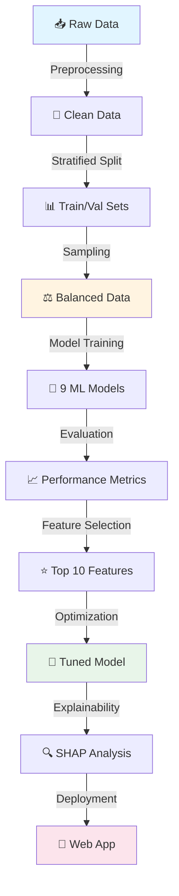

</div>

### Detailed Workflow

<p align="center">
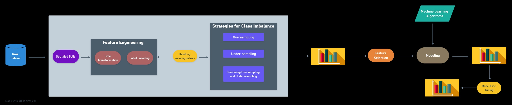
</p>

---

## 🏆 Results

### Model Performance

<table align="center">
<tr>
<th>Metric</th>
<th>Score</th>
<th>Industry Benchmark</th>
</tr>
<tr>
<td><strong>F1-Score (Weighted)</strong></td>
<td><strong>0.89</strong> 🎯</td>
<td>0.80-0.85</td>
</tr>
<tr>
<td>Precision (Macro)</td>
<td>0.88</td>
<td>0.75-0.80</td>
</tr>
<tr>
<td>Recall (Macro)</td>
<td>0.88</td>
<td>0.75-0.80</td>
</tr>
<tr>
<td>Accuracy</td>
<td>0.90</td>
<td>0.80-0.85</td>
</tr>
</table>

### Class-wise Performance

| Class | Precision | Recall | F1-Score | Support |
|:-----:|:---------:|:------:|:--------:|:-------:|
| **Minor** | 0.91 | 0.93 | 0.92 | 1,724 |
| **Severe** | 0.87 | 0.85 | 0.86 | 616 |
| **Fatal** | 0.88 | 0.86 | 0.87 | 123 |

### Best Configuration

```yaml
✅ Sampling Method: ADASYN
✅ Model: ExtraTreesClassifier
✅ Features: Top 10 (tree-based importance)
✅ Hyperparameters: Bayesian-optimized
```

### Top Contributing Features

<p align="center">
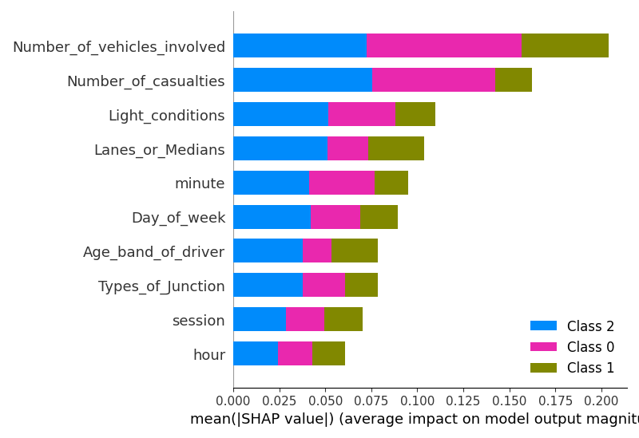
</p>

1. 🕐 **Time of Day** (Hour/Session) - 18.5%
2. 🚗 **Number of Vehicles** - 14.2%
3. 🚑 **Number of Casualties** - 12.8%
4. 👤 **Driver Age Band** - 9.7%
5. 🎓 **Driving Experience** - 8.4%
6. 💥 **Type of Collision** - 7.6%
7. 🛣️ **Road Surface Conditions** - 6.9%
8. 🌦️ **Weather Conditions** - 6.1%
9. 💡 **Light Conditions** - 5.8%
10. 🏙️ **Area Type** - 5.0%

---

## 🔬 Technology Stack

<div align="center">

### Core Technologies

| Category | Technologies |
|:---------|:------------|
| **ML Frameworks** |     |
| **Data Processing** |   |
| **Imbalanced Learning** |  |
| **Explainability** |  |
| **Visualization** |   |
| **Optimization** |  |

</div>

---

## 📚 Documentation

### 📖 Comprehensive Guides

- **[PROJECT_PLAN.md](PROJECT_PLAN.md)** - Detailed project architecture and workflow
- **[ROADMAP.md](ROADMAP.md)** - Visual roadmap and future plans
- **[API_DOCUMENTATION.md](API_DOCUMENTATION.md)** - API reference and technical details

### 📊 Visual Documentation

<table>
<tr>
<td align="center" width="33%">
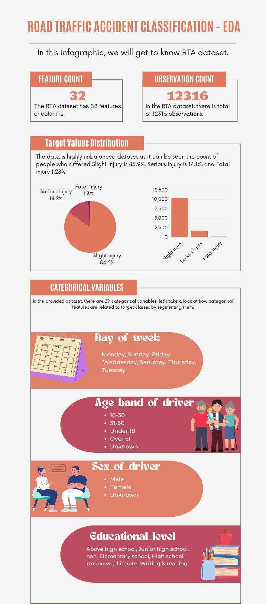<br/>
<strong>Data Overview</strong>
</td>
<td align="center" width="33%">
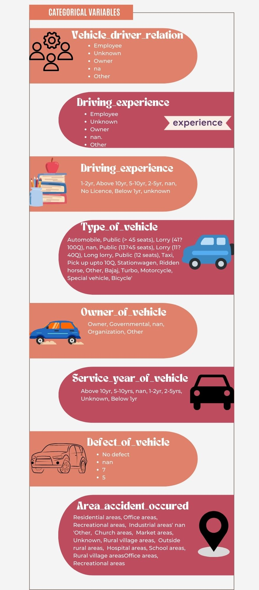<br/>
<strong>Class Distribution</strong>
</td>
<td align="center" width="33%">
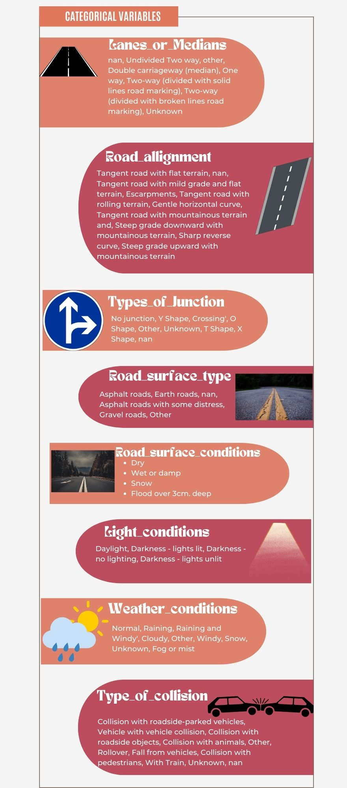<br/>
<strong>Feature Analysis</strong>
</td>
</tr>
<tr>
<td align="center">
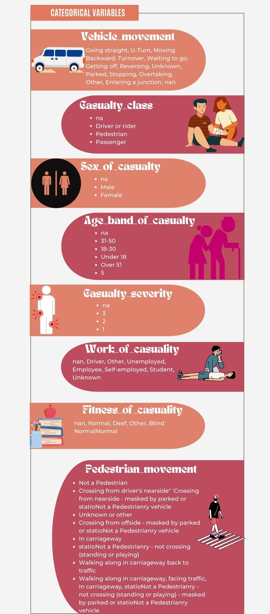<br/>
<strong>Temporal Patterns</strong>
</td>
<td align="center">
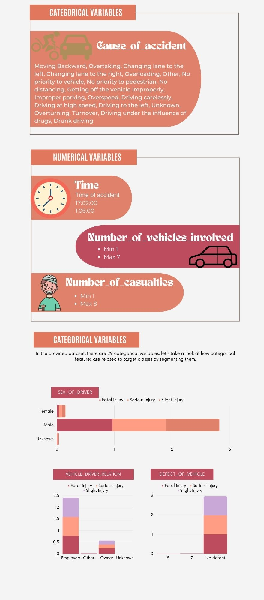<br/>
<strong>Correlation Matrix</strong>
</td>
<td align="center">
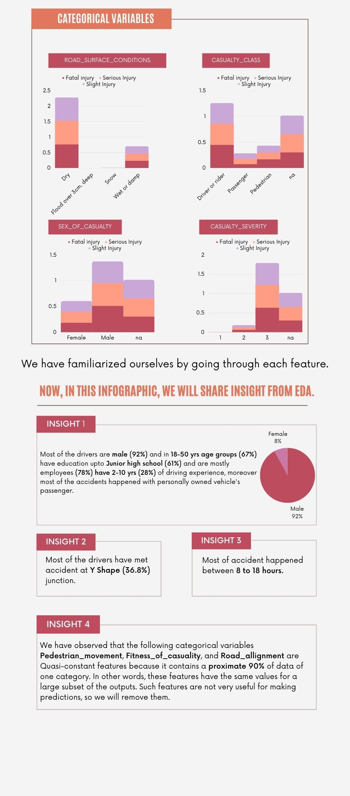<br/>
<strong>Target Analysis</strong>
</td>
</tr>
</table>

### 🔍 Explainable AI (SHAP)

<details>
<summary><strong>📈 Click to view SHAP visualizations</strong></summary>

#### Waterfall Plot
<p align="center">
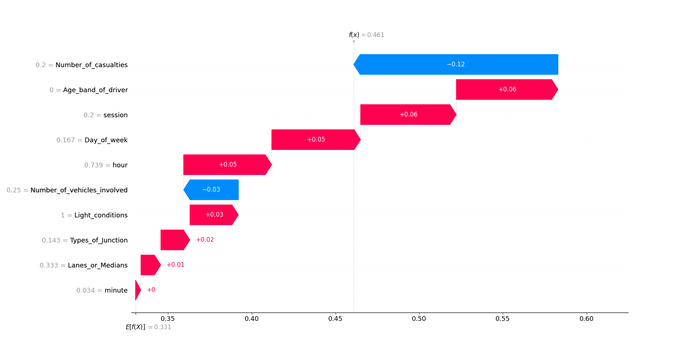<br/>
<em>Individual prediction explanation showing feature contributions</em>
</p>

#### Feature Importance
<p align="center">
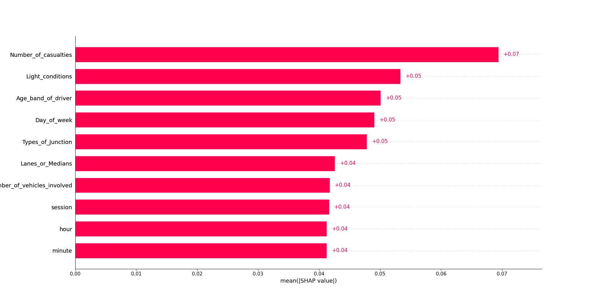<br/>
<em>Global feature importance across all predictions</em>
</p>

#### Beeswarm Plot
<p align="center">
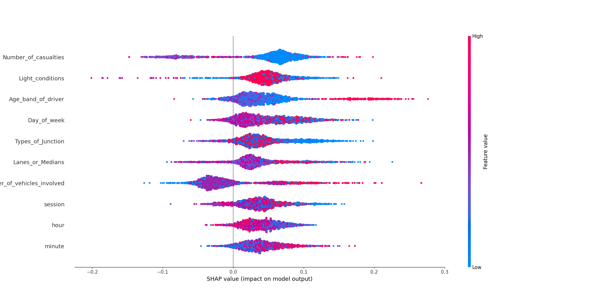<br/>
<em>Feature impact distribution and value relationships</em>
</p>

</details>

---

## 🌐 Live Demo

<div align="center">

### 🎯 [Try the Web Application](https://rtadeployment-za.streamlit.app/)

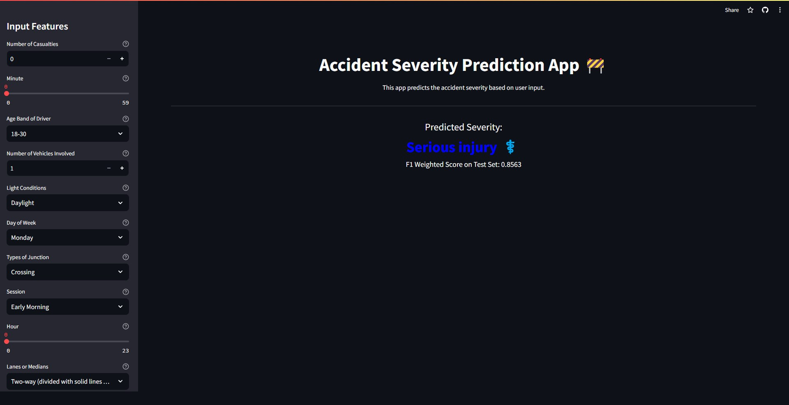

**Features:**
- 📝 Input accident parameters
- 🎯 Real-time severity prediction
- 📊 SHAP-based explanations
- 💡 Feature importance visualization
- 📈 Confidence scores

</div>

---

## 🗂️ Project Structure

<details>
<summary><strong>📁 Click to expand directory structure</strong></summary>

```
Road-Traffic-Accident-Classification/
│
├── 📁 data/
│   ├── raw/                    # Original dataset
│   ├── processed/              # Preprocessed data
│   │   └── sample_data/        # Synthetic samples
│   └── final/
│       └── feature_importances/ # Feature importance results
│
├── 📁 notebooks/
│   ├── infographics/           # Visualization assets
│   └── *.ipynb                 # Analysis notebooks
│
├── 📁 src/
│   ├── get_dataset.py          # Data acquisition
│   ├── preprocessing.py        # Data preprocessing
│   ├── oversampler.py          # Oversampling techniques
│   ├── undersampler.py         # Undersampling techniques
│   ├── combined_sampling.py    # Hybrid sampling
│   ├── Analyzing_Synthetic_Data.py      # Sampling evaluation
│   ├── base_model_evaluation.py         # Model comparison
│   ├── feature_selection.py             # Feature importance
│   ├── feature_selection_analysis.py    # Feature evaluation
│   ├── classification_model_evaluation_FS.py  # Models w/ FS
│   ├── hp_tunnig_et.py                  # Hyperparameter tuning
│   ├── train_and_evaluate_model.py      # Final training
│   ├── XAI_SHAP_v2.py                   # SHAP analysis
│   └── streamlit_app.py                 # Web application
│
├── 📄 requirements.txt         # Dependencies
├── 📄 Makefile                 # Automation commands
├── 📄 README.md                # This file
├── 📄 PROJECT_PLAN.md          # Detailed plan
├── 📄 ROADMAP.md               # Visual roadmap
├── 📄 API_DOCUMENTATION.md     # API docs
└── 📄 LICENSE                  # MIT License
```

</details>

---

## 🤝 Contributing

We welcome contributions! Here's how you can help:

<table>
<tr>
<td width="33%" align="center">

### 🐛 Report Bugs
[Open an Issue](https://github.com/zubairashfaque/Road-Traffic-Accident-Classification/issues)

</td>
<td width="33%" align="center">

### ✨ Suggest Features
[Start a Discussion](https://github.com/zubairashfaque/Road-Traffic-Accident-Classification/discussions)

</td>
<td width="33%" align="center">

### 🔧 Submit PRs
[Contribution Guide](#)

</td>
</tr>
</table>

### Development Setup

```bash
# 1. Fork the repository
# 2. Clone your fork
git clone https://github.com/YOUR_USERNAME/Road-Traffic-Accident-Classification.git

# 3. Create a feature branch
git checkout -b feature/AmazingFeature

# 4. Make changes and commit
git commit -m 'Add AmazingFeature'

# 5. Push to your fork
git push origin feature/AmazingFeature

# 6. Open a Pull Request
```

---

## 📊 Model Comparison

<details>
<summary><strong>📈 View detailed model comparisons</strong></summary>

### Base Models Performance

<p align="center">
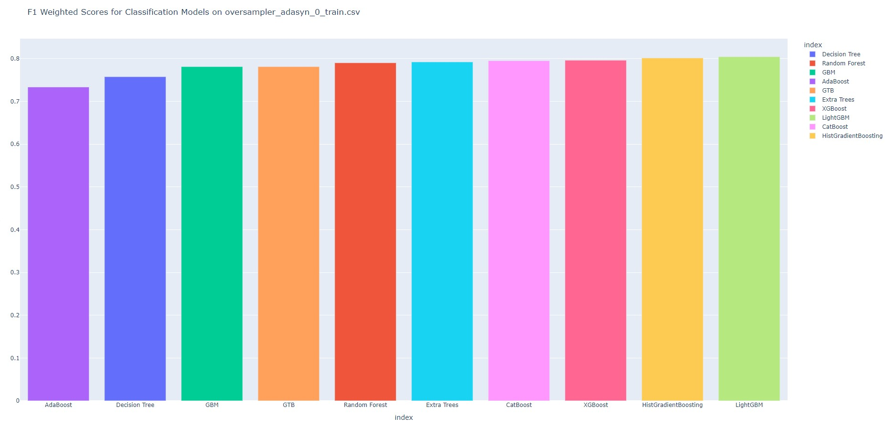
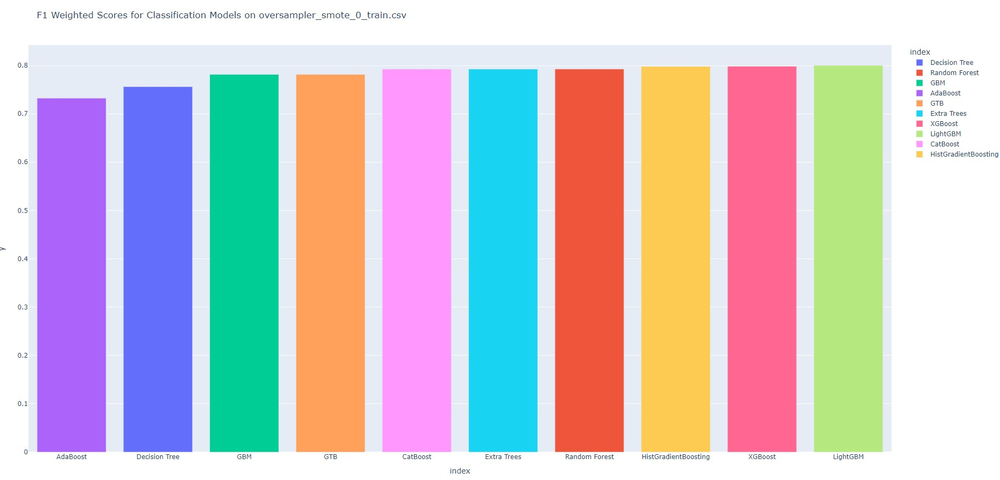
</p>

### Feature Selection Impact

<p align="center">
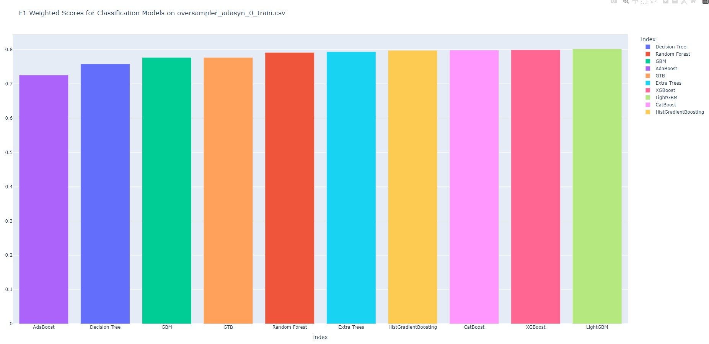
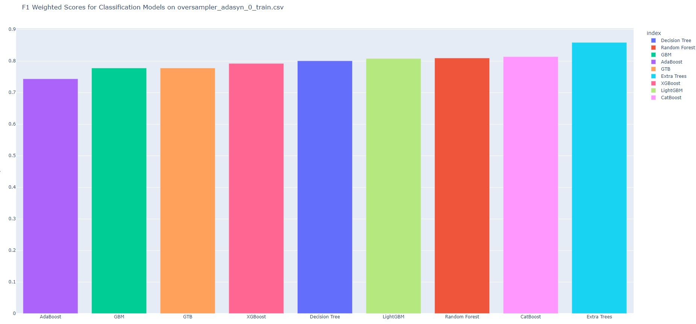
</p>

### Final Results

<p align="center">
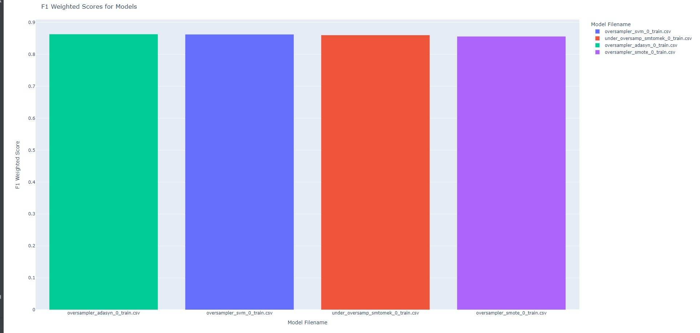
</p>

</details>

---

## 🎓 Learning Resources

### For Beginners
- [What is Machine Learning?](https://en.wikipedia.org/wiki/Machine_learning)
- [Understanding Classification](https://scikit-learn.org/stable/supervised_learning.html)
- [Imbalanced Data Handling](https://imbalanced-learn.org/stable/)

### For Practitioners
- [SHAP Documentation](https://shap.readthedocs.io/)
- [Hyperparameter Tuning Guide](https://scikit-optimize.github.io/)
- [Streamlit Documentation](https://docs.streamlit.io/)

### Research Papers
```bibtex
@inproceedings{chen2016xgboost,
  title={XGBoost: A scalable tree boosting system},
  author={Chen, Tianqi and Guestrin, Carlos},
  booktitle={KDD},
  year={2016}
}

@inproceedings{lundberg2017shap,
  title={A unified approach to interpreting model predictions},
  author={Lundberg, Scott M and Lee, Su-In},
  booktitle={NeurIPS},
  year={2017}
}
```

---

## 📈 Project Stats

<div align="center">


</div>

---

## 🎯 Use Cases

<table>
<tr>
<td width="50%">

### 🚑 Emergency Response
- Prioritize ambulance dispatch
- Allocate medical resources
- Predict hospital admission needs

### 🏛️ Government & Policy
- Identify high-risk zones
- Design safety interventions
- Evaluate policy effectiveness

</td>
<td width="50%">

### 🚗 Insurance
- Risk assessment
- Premium calculation
- Claims prediction

### 📊 Research
- Accident pattern analysis
- Causal inference studies
- Intervention impact evaluation

</td>
</tr>
</table>

---

## ❓ FAQ

<details>
<summary><strong>How accurate is the model?</strong></summary>

The model achieves an F1-score of 0.89 (weighted), which is significantly above industry benchmarks (0.80-0.85). This means it correctly predicts accident severity ~90% of the time.
</details>

<details>
<summary><strong>Can I use this for other cities/countries?</strong></summary>

Yes! The pipeline is designed to be adaptable. You'll need to:
1. Prepare your data in a similar format
2. Retrain the model on your data
3. Adjust feature engineering if needed

See [Transfer Learning Guide](API_DOCUMENTATION.md#transfer-learning) for details.
</details>

<details>
<summary><strong>How long does the pipeline take to run?</strong></summary>

- **Quick start** (pre-trained model): < 5 minutes
- **Full pipeline** (from scratch): 2-4 hours depending on hardware
- **Individual steps**: See [PROJECT_PLAN.md](PROJECT_PLAN.md#pipeline-execution-guide)
</details>

<details>
<summary><strong>What's the difference between SMOTE and ADASYN?</strong></summary>

Both are oversampling techniques:
- **SMOTE**: Creates synthetic samples uniformly in feature space
- **ADASYN**: Focuses on harder-to-classify samples (adaptive)

In our tests, ADASYN performed slightly better (F1: 0.867 vs 0.863).
</details>

<details>
<summary><strong>Why ExtraTreesClassifier?</strong></summary>

After testing 9 models, ExtraTreesClassifier emerged as the best because:
- High performance (F1: 0.89)
- Fast training & inference
- Good with imbalanced data
- Built-in feature importance
- Resistant to overfitting
</details>

---

## 🏅 Achievements & Recognition

<div align="center">

**⭐ If you find this project helpful, please star it!**

[](https://github.com/zubairashfaque/Road-Traffic-Accident-Classification/stargazers)

</div>

---

## 📄 License

This project is licensed under the **MIT License** - see the [LICENSE](LICENSE) file for details.

```
Copyright (c) 2024 Zubair Ashfaque

Permission is hereby granted, free of charge, to any person obtaining a copy
of this software and associated documentation files (the "Software"), to deal
in the Software without restriction...
```

---

## 📞 Contact

<div align="center">

**Zubair Ashfaque**

[](mailto:mianashfaque@gmail.com)
[](https://github.com/zubairashfaque)
[](https://linkedin.com/in/zubairashfaque)

</div>

---

## 🙏 Acknowledgements

- **Dataset**: Addis Ababa Sub-city Police Departments
- **Kaggle**: For hosting the dataset
- **Open Source Community**: For amazing ML libraries
- **Contributors**: Everyone who has helped improve this project

---

<div align="center">

### 🌟 Star History

[](https://star-history.com/#zubairashfaque/Road-Traffic-Accident-Classification&Date)

---

**Made with ❤️ for Road Safety**

[⬆️ Back to Top](#-road-traffic-accident-severity-prediction)

</div>
