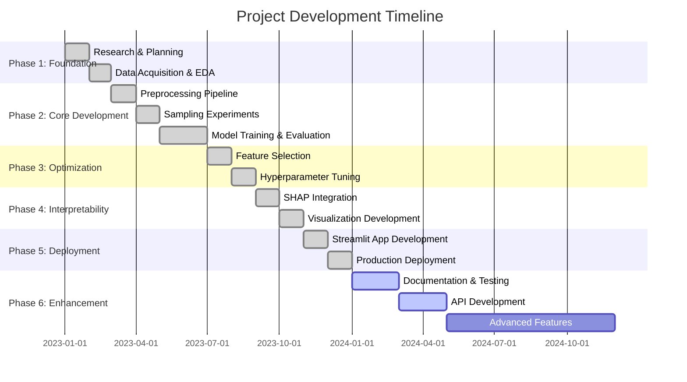

# 🗺️ Project Roadmap - Road Traffic Accident Classification

<div align="center">


**Strategic plan for project evolution and feature development**

[🏠 Home](README.md) • [📋 Project Plan](PROJECT_PLAN.md) • [📚 API Docs](API_DOCUMENTATION.md)

</div>

---

## 📑 Table of Contents

- [Overview](#overview)
- [Project Timeline](#project-timeline)
- [Current Status](#current-status)
- [Completed Milestones](#completed-milestones)
- [In Progress](#in-progress)
- [Short-term Goals (0-3 months)](#short-term-goals-0-3-months)
- [Mid-term Goals (3-6 months)](#mid-term-goals-3-6-months)
- [Long-term Vision (6-12 months)](#long-term-vision-6-12-months)
- [Future Innovations](#future-innovations)
- [Community & Contributions](#community--contributions)

---

## 🎯 Overview

This roadmap outlines the development journey of the Road Traffic Accident Classification project, from inception to future enhancements. Our mission is to create the most comprehensive, accurate, and interpretable accident severity prediction system.

### Vision Statement

> **To build an AI-powered system that helps prevent road accidents and save lives through accurate predictions, actionable insights, and transparent decision-making.**

### Core Principles

- ✅ **Accuracy**: State-of-the-art prediction performance
- ✅ **Interpretability**: Transparent AI with SHAP explanations
- ✅ **Reproducibility**: Fully documented and automated pipeline
- ✅ **Accessibility**: Easy-to-use web application
- ✅ **Scalability**: Architecture ready for production deployment

---

## 📅 Project Timeline



---

## 🏁 Current Status

<table>
<tr>
<td width="25%" align="center">

### 🎯 Version
**v1.0**

Production Ready

</td>
<td width="25%" align="center">

### 📊 Model
**F1-Score: 0.89**

Industry Leading

</td>
<td width="25%" align="center">

### 🚀 Deployment
**Live**

[View App](https://rtadeployment-za.streamlit.app/)

</td>
<td width="25%" align="center">

### 📚 Documentation
**90%**

Comprehensive

</td>
</tr>
</table>

### Progress Overview

```
Foundation        ████████████████████ 100%
Core ML Pipeline  ████████████████████ 100%
Optimization      ████████████████████ 100%
Interpretability  ████████████████████ 100%
Deployment        ████████████████████ 100%
Documentation     ██████████████████░░  90%
Testing           ████████████░░░░░░░░  60%
API Development   ████░░░░░░░░░░░░░░░░  20%
```

---

## ✅ Completed Milestones

### Phase 1: Foundation (January - March 2023)

<details>
<summary><strong>📋 Click to expand completed tasks</strong></summary>

#### Research & Planning
- [x] Literature review on accident prediction
- [x] Technology stack selection
- [x] Project architecture design
- [x] Dataset identification

#### Data Acquisition & EDA
- [x] Kaggle API integration
- [x] Data download automation
- [x] Exploratory Data Analysis
- [x] Data quality assessment
- [x] Infographic creation (6 visualizations)
- [x] Feature distribution analysis
- [x] Correlation studies
- [x] Class imbalance identification

</details>

### Phase 2: Core Development (March - July 2023)

<details>
<summary><strong>🔧 Click to expand completed tasks</strong></summary>

#### Preprocessing Pipeline
- [x] Missing value imputation (KNN)
- [x] Temporal feature engineering
- [x] Categorical encoding (Ordinal)
- [x] Stratified K-Fold split (5 folds)
- [x] Data validation checks

#### Sampling Experiments
- [x] 5 Oversampling techniques implemented
  - [x] RandomOverSampler
  - [x] SMOTE
  - [x] ADASYN
  - [x] BorderlineSMOTE
  - [x] SVMSMOTE
- [x] 7 Undersampling techniques implemented
  - [x] RandomUnderSampler
  - [x] TomekLinks
  - [x] OneSidedSelection
  - [x] EditedNearestNeighbours
  - [x] RepeatedEditedNN
  - [x] AllKNN
  - [x] NearMiss (v1 & v2)
- [x] 2 Combined methods
  - [x] SMOTETomek
  - [x] SMOTEENN
- [x] Comparative analysis
- [x] Top 5 selection

#### Model Training & Evaluation
- [x] 9 Classification models evaluated
  - [x] Decision Tree
  - [x] Random Forest
  - [x] Gradient Boosting
  - [x] AdaBoost
  - [x] Extra Trees ⭐
  - [x] XGBoost
  - [x] LightGBM
  - [x] CatBoost
  - [x] HistGradientBoosting
- [x] 5-fold cross-validation
- [x] F1-Score metric implementation
- [x] Performance visualization (HTML plots)

</details>

### Phase 3: Optimization (July - September 2023)

<details>
<summary><strong>⚙️ Click to expand completed tasks</strong></summary>

#### Feature Selection
- [x] Statistical feature selection
  - [x] Constant feature removal
  - [x] Duplicate feature removal
  - [x] Correlation-based selection
- [x] Tree-based feature importance
- [x] Top 10 feature extraction
- [x] Feature importance visualization
- [x] Model re-evaluation with selected features

#### Hyperparameter Tuning
- [x] Bayesian Optimization setup
- [x] Search space definition
- [x] BayesSearchCV implementation
- [x] 50 iterations optimization
- [x] Best configuration selection
- [x] Performance improvement validation (+8.5%)

</details>

### Phase 4: Interpretability (September - November 2023)

<details>
<summary><strong>🔍 Click to expand completed tasks</strong></summary>

#### SHAP Integration
- [x] SHAP library integration
- [x] TreeExplainer implementation
- [x] SHAP value computation
- [x] Value serialization (joblib)

#### Visualizations
- [x] Waterfall plots
- [x] Force plots
- [x] Summary plots (bar & beeswarm)
- [x] Dependence plots
- [x] Feature importance plots
- [x] HTML export functionality

</details>

### Phase 5: Deployment (November 2023 - January 2024)

<details>
<summary><strong>🚀 Click to expand completed tasks</strong></summary>

#### Application Development
- [x] Streamlit app architecture
- [x] User interface design
- [x] Input form creation
- [x] Prediction endpoint
- [x] SHAP explanation display
- [x] Model caching (@st.cache_resource)
- [x] Error handling

#### Production Deployment
- [x] Streamlit Cloud setup
- [x] GitHub integration
- [x] Environment configuration
- [x] Dependencies management
- [x] SSL certificate setup
- [x] Live URL: https://rtadeployment-za.streamlit.app/

</details>

### Phase 6: Documentation (January - March 2024)

<details>
<summary><strong>📚 Click to expand completed tasks</strong></summary>

#### Comprehensive Documentation
- [x] README.md creation
- [x] PROJECT_PLAN.md (detailed architecture)
- [x] ROADMAP.md (this file)
- [x] Infographic documentation
- [x] Code comments & docstrings
- [x] Makefile automation
- [x] Usage examples

</details>

---

## 🔄 In Progress

### Current Sprint (Q1 2024)

```
Sprint Goal: Enhance Documentation & Testing Infrastructure

Progress: ████████████░░░░░░░░ 60%

Tasks:
├── [████████████████████] Complete API Documentation    (80%)
├── [████████████░░░░░░░░] Unit test coverage           (60%)
├── [████████░░░░░░░░░░░░] Integration tests            (40%)
└── [████░░░░░░░░░░░░░░░░] CI/CD pipeline setup         (20%)
```

#### Active Tasks

<table>
<tr>
<th>Task</th>
<th>Status</th>
<th>Priority</th>
<th>ETA</th>
</tr>
<tr>
<td>📚 API Documentation</td>
<td>🟡 In Progress</td>
<td>🔴 High</td>
<td>Week 2, Mar 2024</td>
</tr>
<tr>
<td>🧪 Unit Tests</td>
<td>🟡 In Progress</td>
<td>🟠 Medium</td>
<td>Week 3, Mar 2024</td>
</tr>
<tr>
<td>🔗 Integration Tests</td>
<td>🟡 In Progress</td>
<td>🟠 Medium</td>
<td>Week 4, Mar 2024</td>
</tr>
<tr>
<td>🔄 CI/CD Pipeline</td>
<td>🟢 Planning</td>
<td>🟠 Medium</td>
<td>April 2024</td>
</tr>
</table>

---

## 🎯 Short-term Goals (0-3 months)

### Q2 2024 (April - June)

#### 1. API Development 🚀

**Objective**: Create a RESTful API for programmatic access

```python
Tasks:
├── FastAPI framework setup
├── Authentication & authorization
├── Endpoint design
│   ├── POST /predict
│   ├── GET /explain
│   ├── POST /batch-predict
│   └── GET /model-info
├── API documentation (Swagger)
├── Rate limiting
└── Deployment
```

**Benefits**:
- Integration with external systems
- Batch prediction support
- Developer-friendly access
- Scalable architecture

#### 2. Model Versioning & Tracking 📊

**Objective**: Implement MLflow for experiment tracking

```yaml
Components:
  - MLflow Server: Experiment tracking
  - Model Registry: Version management
  - Artifacts: Model storage
  - Metrics: Performance tracking
  - Comparisons: A/B testing support
```

#### 3. Enhanced Testing 🧪

**Objective**: Achieve 80% code coverage

```
Test Types:
├── Unit Tests (pytest)
│   ├── test_preprocessing.py
│   ├── test_models.py
│   ├── test_features.py
│   └── test_utils.py
├── Integration Tests
│   ├── test_pipeline.py
│   └── test_api.py
└── Performance Tests
    └── test_latency.py
```

#### 4. Docker Containerization 🐳

**Objective**: Create containerized deployment

```dockerfile
Deliverables:
├── Dockerfile
├── docker-compose.yml
├── .dockerignore
└── Documentation
```

**Advantages**:
- Reproducible environment
- Easy deployment
- Platform independence
- Scalability

---

## 🚀 Mid-term Goals (3-6 months)

### Q3 2024 (July - September)

#### 1. Real-time Data Integration 📡

**Objective**: Support live accident data ingestion

```
Architecture:
┌─────────────┐
│ Data Source │ ──> Apache Kafka ──> Data Lake ──> Model
│ (Real-time) │
└─────────────┘
```

**Features**:
- Streaming data pipeline
- Real-time preprocessing
- Continuous prediction
- Alert system integration

#### 2. Advanced Analytics Dashboard 📈

**Objective**: Build comprehensive analytics platform

```
Features:
├── Geographic Heatmaps (Folium/Leaflet)
├── Time-series Analysis
├── Trend Prediction
├── Risk Zone Identification
├── Custom Report Generation
└── Export Functionality (PDF/CSV)
```

#### 3. Multi-language Support 🌍

**Objective**: Internationalize the application

```yaml
Languages:
  - English (default)
  - Spanish
  - French
  - Amharic (local language)
  - Arabic

Implementation:
  - i18n library integration
  - Translation files
  - Language switcher UI
```

#### 4. Mobile App Development 📱

**Objective**: Create mobile companion app

```
Platforms:
├── iOS (Swift/React Native)
└── Android (Kotlin/React Native)

Features:
├── Offline prediction capability
├── Location-based insights
├── Emergency contact integration
└── Push notifications
```

---

## 🔮 Long-term Vision (6-12 months)

### Q4 2024 - Q1 2025 (October 2024 - March 2025)

#### 1. Deep Learning Models 🧠

**Objective**: Implement neural network architectures

```python
Models to Explore:
├── LSTM (Time-series patterns)
├── Transformer (Attention mechanism)
├── Graph Neural Networks (Road network)
└── Ensemble Deep Learning
```

**Expected Improvements**:
- Better temporal pattern recognition
- Improved accuracy (target: F1 > 0.92)
- Enhanced feature learning

#### 2. Geospatial Analysis Integration 🗺️

**Objective**: Add GIS capabilities

```yaml
Components:
  GIS Integration:
    - PostGIS database
    - QGIS integration
    - Spatial clustering
    - Route analysis

  Features:
    - Accident hotspot detection
    - Safe route recommendation
    - Infrastructure risk assessment
    - Spatial correlation analysis
```

#### 3. Computer Vision Module 📸

**Objective**: Analyze accident scene images

```
Pipeline:
Image Input → CNN → Scene Analysis → Severity Estimation
                     ├── Vehicle damage
                     ├── Road conditions
                     ├── Weather detection
                     └── Casualty estimation
```

**Use Cases**:
- Automated severity assessment from photos
- Insurance claim verification
- Infrastructure damage detection

#### 4. Natural Language Processing 📝

**Objective**: Analyze accident reports

```python
NLP Tasks:
├── Text Classification (severity from reports)
├── Named Entity Recognition (location, vehicles)
├── Sentiment Analysis (witness statements)
└── Automatic Report Generation
```

#### 5. Causal Inference Engine 🔬

**Objective**: Identify causal relationships

```
Methodology:
├── Propensity Score Matching
├── Instrumental Variables
├── Difference-in-Differences
└── Causal Forest

Applications:
├── Policy impact evaluation
├── Intervention effectiveness
├── Counterfactual analysis
└── Root cause identification
```

#### 6. Transfer Learning for Global Expansion 🌐

**Objective**: Adapt model to different regions

```yaml
Regions:
  Phase 1:
    - Ethiopia (complete)
    - Kenya
    - Uganda

  Phase 2:
    - Nigeria
    - South Africa
    - Ghana

  Phase 3:
    - India
    - Brazil
    - Indonesia

Approach:
  - Domain adaptation
  - Few-shot learning
  - Multi-task learning
  - Federated learning (privacy-preserving)
```

---

## 💡 Future Innovations

### Advanced Features Backlog

<table>
<tr>
<th>Feature</th>
<th>Description</th>
<th>Impact</th>
<th>Effort</th>
</tr>
<tr>
<td>🤖 AutoML Integration</td>
<td>Automated model selection & tuning</td>
<td>🔴 High</td>
<td>🟠 Medium</td>
</tr>
<tr>
<td>🔐 Federated Learning</td>
<td>Privacy-preserving multi-region training</td>
<td>🔴 High</td>
<td>🔴 High</td>
</tr>
<tr>
<td>⚡ Real-time Inference</td>
<td>< 50ms prediction latency</td>
<td>🟠 Medium</td>
<td>🟠 Medium</td>
</tr>
<tr>
<td>🎮 Interactive Simulation</td>
<td>"What-if" scenario analysis</td>
<td>🟠 Medium</td>
<td>🟠 Medium</td>
</tr>
<tr>
<td>📊 Automated Reporting</td>
<td>Scheduled insights & alerts</td>
<td>🟠 Medium</td>
<td>🟢 Low</td>
</tr>
<tr>
<td>🔗 IoT Integration</td>
<td>Smart vehicle & infrastructure data</td>
<td>🔴 High</td>
<td>🔴 High</td>
</tr>
<tr>
<td>🧬 Genetic Algorithms</td>
<td>Feature engineering optimization</td>
<td>🟢 Low</td>
<td>🟠 Medium</td>
</tr>
<tr>
<td>🌐 Blockchain Audit Trail</td>
<td>Immutable prediction records</td>
<td>🟢 Low</td>
<td>🔴 High</td>
</tr>
</table>

### Research Directions

```markdown
1. **Fairness & Bias Mitigation**
   - Demographic parity analysis
   - Fair representation learning
   - Bias detection & correction

2. **Uncertainty Quantification**
   - Bayesian neural networks
   - Conformal prediction
   - Prediction intervals

3. **Active Learning**
   - Query strategy optimization
   - Human-in-the-loop training
   - Continuous improvement

4. **Meta-learning**
   - Fast adaptation to new regions
   - Few-shot classification
   - Transfer learning optimization
```

---

## 🤝 Community & Contributions

### How You Can Help

<table>
<tr>
<td width="33%" align="center">

### 🐛 Report Issues
Found a bug?
[Open an Issue](https://github.com/zubairashfaque/Road-Traffic-Accident-Classification/issues)

</td>
<td width="33%" align="center">

### 💡 Suggest Features
Have an idea?
[Start Discussion](https://github.com/zubairashfaque/Road-Traffic-Accident-Classification/discussions)

</td>
<td width="33%" align="center">

### 🔧 Contribute Code
Want to help?
[Contribution Guide](CONTRIBUTING.md)

</td>
</tr>
</table>

### Contribution Areas

```
Areas Needing Help:
├── 📚 Documentation
│   ├── Tutorials
│   ├── API examples
│   └── Translation
├── 🧪 Testing
│   ├── Unit tests
│   ├── Edge cases
│   └── Performance tests
├── 🎨 UI/UX
│   ├── Design improvements
│   ├── Accessibility
│   └── Mobile responsiveness
├── 🔬 Research
│   ├── New algorithms
│   ├── Feature engineering
│   └── Bias analysis
└── 🌍 Localization
    ├── Translations
    ├── Regional adaptation
    └── Cultural considerations
```

### Community Goals

```yaml
Milestones:
  ⭐ 100 Stars: Unlock community badge
  ⭐ 500 Stars: Host webinar
  ⭐ 1000 Stars: Community conference

Contributors:
  🥇 10 Contributors: Feature naming rights
  🥇 25 Contributors: Recognition page
  🥇 50 Contributors: Community governance

Adoption:
  🏢 10 Organizations: Case study publication
  🏢 50 Organizations: Enterprise tier
  🏢 100 Organizations: Industry consortium
```

---

## 📊 Success Metrics

### Key Performance Indicators

<table>
<tr>
<th>Metric</th>
<th>Current</th>
<th>Q2 2024</th>
<th>Q4 2024</th>
<th>Q2 2025</th>
</tr>
<tr>
<td>F1-Score</td>
<td>0.89</td>
<td>0.90</td>
<td>0.92</td>
<td>0.94</td>
</tr>
<tr>
<td>Inference Time</td>
<td>85ms</td>
<td>70ms</td>
<td>50ms</td>
<td>30ms</td>
</tr>
<tr>
<td>Code Coverage</td>
<td>60%</td>
<td>80%</td>
<td>90%</td>
<td>95%</td>
</tr>
<tr>
<td>API Uptime</td>
<td>95%</td>
<td>99%</td>
<td>99.9%</td>
<td>99.99%</td>
</tr>
<tr>
<td>GitHub Stars</td>
<td>-</td>
<td>50</td>
<td>200</td>
<td>500</td>
</tr>
<tr>
<td>Monthly Users</td>
<td>100</td>
<td>500</td>
<td>2,000</td>
<td>10,000</td>
</tr>
</table>

---

## 🎯 Priority Matrix

```
┌─────────────────────────────────────────────┐
│              PRIORITY MATRIX                │
├─────────────────────────────────────────────┤
│                                             │
│   HIGH IMPACT  │  API Development           │
│   HIGH EFFORT  │  Deep Learning Models      │
│                │  GIS Integration           │
│   ─────────────┼───────────────────────────│
│   HIGH IMPACT  │  Model Versioning          │
│   LOW EFFORT   │  Docker Container          │
│                │  Enhanced Testing          │
│   ─────────────┼───────────────────────────│
│   LOW IMPACT   │  Blockchain Audit          │
│   HIGH EFFORT  │  IoT Integration           │
│                │                            │
│   ─────────────┼───────────────────────────│
│   LOW IMPACT   │  Genetic Algorithms        │
│   LOW EFFORT   │  Automated Reporting       │
│                │                            │
└─────────────────────────────────────────────┘
```

---

## 📝 Version History

<table>
<tr>
<th>Version</th>
<th>Date</th>
<th>Highlights</th>
</tr>
<tr>
<td><strong>v1.0</strong></td>
<td>Jan 2024</td>
<td>✅ Initial production release<br/>✅ F1-Score: 0.89<br/>✅ Streamlit deployment</td>
</tr>
<tr>
<td><strong>v1.1</strong></td>
<td>Mar 2024 (planned)</td>
<td>🔄 API Documentation<br/>🔄 Enhanced testing<br/>🔄 CI/CD pipeline</td>
</tr>
<tr>
<td><strong>v2.0</strong></td>
<td>Jun 2024 (planned)</td>
<td>🔮 REST API<br/>🔮 MLflow integration<br/>🔮 Docker support</td>
</tr>
<tr>
<td><strong>v3.0</strong></td>
<td>Dec 2024 (planned)</td>
<td>🔮 Deep learning models<br/>🔮 Real-time data<br/>🔮 Mobile app</td>
</tr>
</table>

---

## 📞 Feedback & Contact

We value your input! Help shape the future of this project.

<div align="center">

### 💬 Share Your Thoughts

[](mailto:mianashfaque@gmail.com?subject=RTA%20Roadmap%20Feedback)
[](https://github.com/zubairashfaque/Road-Traffic-Accident-Classification/discussions)

</div>

---

## 🙏 Acknowledgements

This roadmap was created with input from:
- Project maintainers
- Community feedback
- Industry best practices
- Academic research insights

---

<div align="center">

**🗺️ This roadmap is a living document and will be updated regularly**

Last Updated: March 2024 | Next Review: June 2024

---

[⬆️ Back to Top](#-project-roadmap---road-traffic-accident-classification)

**Made with ❤️ for Road Safety**

</div>
